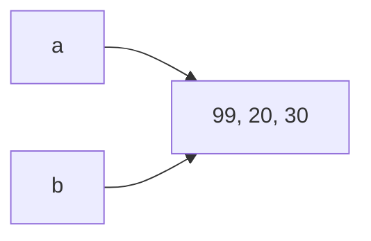

- TOC
{:toc}

## Why arrays?

Suppose you need to store the marks of 200 students. Declaring `mark1`, `mark2`, ..., `mark200` is clearly not workable, and you couldn't loop over them anyway.

An **array** is a single variable that holds a fixed number of values, all of the same type. Each value is identified by its position, called its **index**.

## Creating an array

### With a given size

```java
int[] marks = new int[5];
```

- `int[]` is the type: "array of `int`".
- `new int[5]` creates an array with room for 5 `int`s.
- Every item starts at a **default value**: `0` for `int`, `0.0` for `double`, `false` for `boolean`, `null` for `String` and other objects.

### With known values

```java
int[] marks = {72, 85, 64, 90, 58};
```

The size (5) is worked out from the number of values listed.

## Indexing

Items are numbered from **0** up to **length - 1**:

| index    | 0  | 1  | 2  | 3  | 4  |
|----------|----|----|----|----|----|
| `marks`  | 72 | 85 | 64 | 90 | 58 |

```java
int first = marks[0];                  // 72
int last = marks[marks.length - 1];    // 58
marks[2] = 70;                         // replace 64 with 70
marks[1] = marks[1] + 5;               // 85 becomes 90
```

Each `marks[i]` behaves like an ordinary `int` variable. It can be read, and it can be the LHS of an assignment, which follows the usual [two-step rule]({{ site.baseurl }}/comp1010/comp1000-revision/variables-and-operators#assignment-is-a-two-step-operation):

```java
double[] prices = new double[3];
prices[0] = 5;        // OK: int 5 is copied into a double item as 5.0

int[] counts = new int[3];
counts[0] = 2.5;      // does NOT compile: a double cannot be copied into an int item
```

`marks.length` gives the number of items (note: no brackets, unlike `String`'s `length()`). An array's length is fixed when it is created and can never change.

{: .warning}
> Accessing an index that doesn't exist, such as `marks[5]` or `marks[-1]` here, compiles fine but crashes when the program runs, with an `ArrayIndexOutOfBoundsException`.

## Traversing an array

To do something with every item, loop over every valid index:

```java
for (int i = 0; i < marks.length; i++) {
    System.out.println("Item at index " + i + " is " + marks[i]);
}
```

Use `i < marks.length`, **not** `i <= marks.length`. The last valid index is `length - 1`.

## Common array algorithms

These patterns combine a [loop]({{ site.baseurl }}/comp1010/comp1000-revision/loops#loop-patterns) with an array. They come up constantly in COMP1010.

### Sum and average

```java
int total = 0;
for (int i = 0; i < marks.length; i++) {
    total = total + marks[i];
}
double average = (double) total / marks.length;   // cast, to avoid integer division!
```

### Count items that satisfy a condition

```java
int passCount = 0;
for (int i = 0; i < marks.length; i++) {
    if (marks[i] >= 50) {
        passCount++;
    }
}
```

### Find the largest item

Start with the first item as "the largest so far", then compare each remaining item against it:

```java
int max = marks[0];
for (int i = 1; i < marks.length; i++) {
    if (marks[i] > max) {
        max = marks[i];
    }
}
```

{: .note}
> Don't start `max` at `0`. If every item is negative, `0` would be wrong. Starting from an actual item always works (as long as the array is not empty).

### Search for an item

```java
int target = 90;
int foundAt = -1;           // -1 means "not found"
for (int i = 0; i < marks.length && foundAt == -1; i++) {
    if (marks[i] == target) {
        foundAt = i;
    }
}
```

## Array variables hold references

This is where arrays differ from `int`, `double` and `boolean` variables.

An array variable does **not** hold the items themselves. It holds a **reference** to (the address of) the array, which lives elsewhere in memory.

```java
int[] a = {10, 20, 30};
int[] b = a;
b[0] = 99;
System.out.println(a[0]);   // 99 !
```

Apply the two-step rule to `int[] b = a;`:

1. Evaluate the RHS: `a` evaluates to its value, which is a **reference** to the array.
2. Copy that value into `b`.

So `a` and `b` now hold the *same reference*. There is only one array, with two names for it. Changing it through `b` changes what you see through `a`.



To get an independent copy, create a new array and copy the items across:

```java
int[] c = new int[a.length];
for (int i = 0; i < a.length; i++) {
    c[i] = a[i];
}
c[0] = 1;                    // a is unaffected
```

For the same reason, `a == c` compares **references**: it is `true` only if both refer to the very same array, even if two different arrays hold the same items.

## Arrays and functions

Passing an array to a function copies the **reference**, just as `int[] b = a;` does. The parameter and the caller's variable then refer to the same array, so the function **can** change the caller's array:

```java
public static void doubleAll(int[] data) {
    for (int i = 0; i < data.length; i++) {
        data[i] = data[i] * 2;
    }
}

int[] values = {1, 2, 3};
doubleAll(values);
// values is now {2, 4, 6}
```

Compare this with passing an `int`, where the function only gets a copy of the value and [cannot change the caller's variable]({{ site.baseurl }}/comp1010/comp1000-revision/functions#parameters-are-copies).

Functions can also return arrays:

```java
public static int[] firstN(int n) {
    int[] result = new int[n];
    for (int i = 0; i < n; i++) {
        result[i] = i + 1;
    }
    return result;
}

int[] nums = firstN(4);   // {1, 2, 3, 4}
```

### Handling `null`

An array variable can hold the special value `null`, meaning "no array at all". Reading `.length` or any item of a `null` array crashes with a `NullPointerException`. A robust function checks for it first:

```java
public static int sum(int[] data) {
    if (data == null) {
        return 0;
    }
    int total = 0;
    for (int i = 0; i < data.length; i++) {
        total = total + data[i];
    }
    return total;
}
```

## Exercises


What is the output?

```java
int[] x = new int[4];
x[1] = 7;
x[3] = x[1] * 2;
x[0] = x[3] - x[2];
for (int i = 0; i < x.length; i++) {
    System.out.print(x[i] + " ");
}
```


`x` starts as `{0, 0, 0, 0}`.

- `x[1] = 7` → `{0, 7, 0, 0}`
- `x[3] = 14` → `{0, 7, 0, 14}`
- `x[0] = 14 - 0` → `{14, 7, 0, 14}`

Output: `14 7 0 14 `




What is the output?

```java
int[] p = {1, 2, 3};
int[] q = p;
int[] r = {1, 2, 3};
q[2] = 10;
System.out.println(p[2] + " " + r[2]);
System.out.println((p == q) + " " + (p == r));
```


```
10 3
true false
```

`q` holds the same reference as `p`, so changing `q[2]` changes `p[2]`. `r` is a separate array that happens to hold the same values, so `p == r` is `false`.




Write a function `countEven` that returns how many items of an `int` array are even. Return `0` if the array is `null`.


```java
public static int countEven(int[] data) {
    if (data == null) {
        return 0;
    }
    int count = 0;
    for (int i = 0; i < data.length; i++) {
        if (data[i] % 2 == 0) {
            count++;
        }
    }
    return count;
}
```




Write a function `reverse` that **returns a new array** containing the items of the given array in reverse order. The original array must not change.

For example, if `data` is `{4, 8, 15, 16}`, the function returns `{16, 15, 8, 4}`.


```java
public static int[] reverse(int[] data) {
    int[] result = new int[data.length];
    for (int i = 0; i < data.length; i++) {
        result[i] = data[data.length - 1 - i];
    }
    return result;
}
```




This function is meant to return the index of the smallest item in a non-empty array. Find the two bugs.

```java
public static int indexOfMin(int[] data) {
    int minIndex = 0;
    for (int i = 1; i <= data.length; i++) {
        if (data[i] < minIndex) {
            minIndex = i;
        }
    }
    return minIndex;
}
```


1. `i <= data.length` goes one past the last valid index, which causes an `ArrayIndexOutOfBoundsException`. It should be `i < data.length`.
2. `data[i] < minIndex` compares an item with an *index*. It should compare with the smallest item so far: `data[i] < data[minIndex]`.

```java
public static int indexOfMin(int[] data) {
    int minIndex = 0;
    for (int i = 1; i < data.length; i++) {
        if (data[i] < data[minIndex]) {
            minIndex = i;
        }
    }
    return minIndex;
}
```


