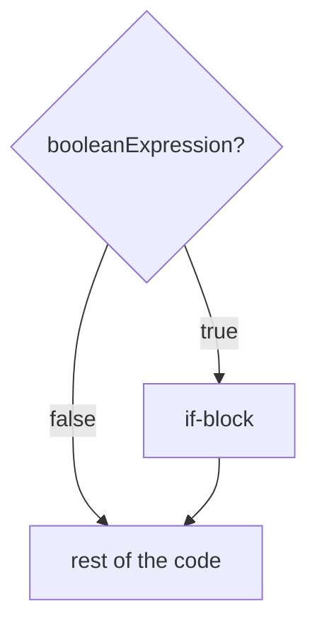
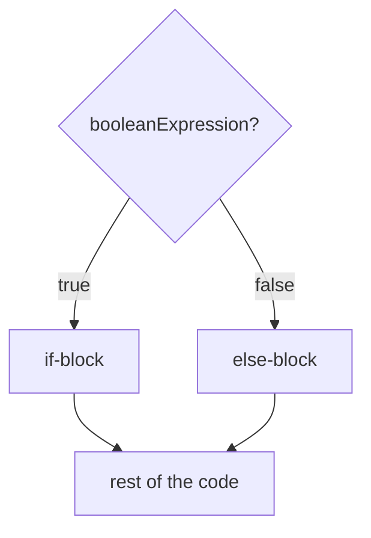

- TOC
{:toc}

## Making decisions

So far, every statement in a program runs exactly once, top to bottom. A **condition** lets the program choose which statements to run, based on a `boolean` value.

Every condition is controlled by a **boolean expression**: an expression whose value is `true` or `false`. If you need a refresher on `==`, `<`, `&&`, `||` and `!`, see [Variables and Operators]({{ site.baseurl }}/comp1010/comp1000-revision/variables-and-operators#relational-operators).

## `if`

```java
if (booleanExpression) {
    // runs only when booleanExpression is true
}
// always runs
```



Example:

```java
int temperature = 34;
String advice = "Enjoy your day";
if (temperature > 30) {
    advice = "Stay hydrated";
}
System.out.println(advice);   // Stay hydrated
```

If `temperature` were `20`, the if-block would be skipped and the output would be `Enjoy your day`.

## `if-else`

Exactly one of the two blocks runs, never both and never neither.

```java
if (booleanExpression) {
    // runs when booleanExpression is true
}
else {
    // runs when booleanExpression is false
}
```



Example:

```java
int n = 13;
String parity;
if (n % 2 == 0) {
    parity = "even";
}
else {
    parity = "odd";
}
```

{: .note}
> When an `if-else` only chooses between two values for a `boolean` variable, you can usually assign the boolean expression directly:
>
> ```java
> boolean isEven = n % 2 == 0;
> ```

## `if-else if-else` chains

When there are more than two outcomes, chain the conditions. Java checks them **from top to bottom** and runs the block of the **first** condition that is `true`. The remaining conditions are not even checked. The final `else` (optional) runs if none of the conditions is `true`.

```java
int mark = 72;
String grade;
if (mark >= 85) {
    grade = "HD";
}
else if (mark >= 75) {
    grade = "D";
}
else if (mark >= 65) {
    grade = "Cr";
}
else if (mark >= 50) {
    grade = "P";
}
else {
    grade = "F";
}
// grade is "Cr"
```

When Java reaches `else if (mark >= 75)`, it already knows `mark >= 85` was `false`. So each branch only has to check the lower bound.

### Order matters

What happens if we write the same chain in a different order?

```java
if (mark >= 50) {
    grade = "P";
}
else if (mark >= 65) {
    grade = "Cr";
}
else if (mark >= 75) {
    grade = "D";
}
else if (mark >= 85) {
    grade = "HD";
}
else {
    grade = "F";
}
```

Every passing mark matches `mark >= 50` first, so everyone who passes gets `"P"`, even with a mark of 99. The other branches can never run. In a chain, put the most specific (most restrictive) conditions first.

### A chain is not the same as separate `if`s

```java
// Version A: chain
if (x > 0) {
    count = count + 1;
}
else if (x > 10) {
    count = count + 10;
}

// Version B: separate if statements
if (x > 0) {
    count = count + 1;
}
if (x > 10) {
    count = count + 10;
}
```

For `x = 20`, version A adds 1 (only the first matching branch runs), while version B adds 11 (each `if` is checked independently). Use a chain when the outcomes are **mutually exclusive**. Use separate `if`s when each check is an **independent** decision.

## Nested conditions

The block of a condition can contain any statements, including other conditions:

```java
if (age >= 18) {
    if (hasTicket) {
        status = "Enter";
    }
    else {
        status = "Buy a ticket first";
    }
}
else {
    status = "Too young";
}
```

A nested `if` with no `else` can often be flattened using `&&`:

```java
if (age >= 18) {
    if (hasTicket) {
        status = "Enter";
    }
}
// is equivalent to
if (age >= 18 && hasTicket) {
    status = "Enter";
}
```

## Common mistakes

### A semicolon after the condition

```java
if (x > 100); {
    System.out.println("big");
}
```

The `;` ends the `if` statement with an empty body. The block `{ ... }` that follows is just an ordinary block, so it **always** runs. Never put a semicolon after `if (...)`.

### Missing braces

```java
if (x > 100)
    System.out.println("big");
    System.out.println("really big");   // NOT part of the if!
```

Without braces, only the first statement belongs to the `if`. The indentation is misleading: the second line always runs. Always use braces, even for a single statement.

### `=` instead of `==`

```java
if (x = 5) { ... }    // does not compile in Java
```

`x = 5` is an assignment, and its value is the `int` `5`. A condition needs a `boolean`, so Java reports `incompatible types: int cannot be converted to boolean`. Compare with `==`.

### Comparing with `== true`

```java
if (isValid == true) { ... }   // works, but redundant
if (isValid) { ... }           // preferred

if (isValid == false) { ... }  // works, but redundant
if (!isValid) { ... }          // preferred
```

### Comparing `String`s with `==`

For `String`s, `==` checks whether two variables refer to the *same object* in memory, not whether they contain the same text. Use `.equals`:

```java
if (name.equals("Alice")) { ... }
```

## Coding from a truth table

Sometimes the requirement is given as a table of inputs and outputs. For example, a function that decides whether an alarm sounds:

| `doorOpen` | `armed` | alarm? |
|------------|---------|--------|
| `false`    | `false` | no     |
| `false`    | `true`  | no     |
| `true`     | `false` | no     |
| `true`     | `true`  | yes    |

The alarm sounds in exactly one row, where both are `true`:

```java
boolean alarm = doorOpen && armed;
```

A useful approach: look at the rows that produce `true`, write an `&&` expression for each row, and join the rows with `||`. Then simplify if you can.

## Exercises


What is the value of `result` after this code executes, for `x = 4`, `x = 7` and `x = 12`?

```java
int result = 0;
if (x > 5) {
    result = result + 10;
}
if (x > 10) {
    result = result + 100;
}
else {
    result = result + 1;
}
```


The first `if` and the `if-else` are separate statements, so both are checked.

- `x = 4`: first `if` is false. Then `x > 10` is false, so +1. `result` is `1`.
- `x = 7`: +10, then +1. `result` is `11`.
- `x = 12`: +10, then +100. `result` is `110`.




Given `int`s `a`, `b` and `c`, write code that stores the largest of the three in a variable `max`.


```java
int max = a;
if (b > max) {
    max = b;
}
if (c > max) {
    max = c;
}
```

Starting with "the answer so far" and updating it is a pattern you will use again with [loops]({{ site.baseurl }}/comp1010/comp1000-revision/loops) and [arrays]({{ site.baseurl }}/comp1010/comp1000-revision/arrays).




The following code is supposed to print `"teen"` for ages 13 to 19 (inclusive), `"child"` for ages below 13, and `"adult"` otherwise. Find the bug.

```java
if (age < 13) {
    System.out.println("child");
}
if (age <= 19) {
    System.out.println("teen");
}
else {
    System.out.println("adult");
}
```


The two `if`s are independent, so an age such as 8 prints **both** `"child"` and `"teen"`. Make it a single chain:

```java
if (age < 13) {
    System.out.println("child");
}
else if (age <= 19) {
    System.out.println("teen");
}
else {
    System.out.println("adult");
}
```




A shop gives free shipping if the order total is at least $100, **or** if the customer is a member and the total is at least $50. Write a boolean expression `freeShipping` using `double total` and `boolean isMember`.


```java
boolean freeShipping = total >= 100 || (isMember && total >= 50);
```




Write code that sets `int` variable `quadrant` to 1, 2, 3 or 4 depending on which quadrant the point (`x`, `y`) lies in, or to 0 if it lies on either axis.

Quadrant 1 is `x > 0, y > 0`; 2 is `x < 0, y > 0`; 3 is `x < 0, y < 0`; 4 is `x > 0, y < 0`.


```java
int quadrant;
if (x == 0 || y == 0) {
    quadrant = 0;
}
else if (x > 0 && y > 0) {
    quadrant = 1;
}
else if (x < 0 && y > 0) {
    quadrant = 2;
}
else if (x < 0) {   // y must be < 0 here
    quadrant = 3;
}
else {
    quadrant = 4;
}
```


