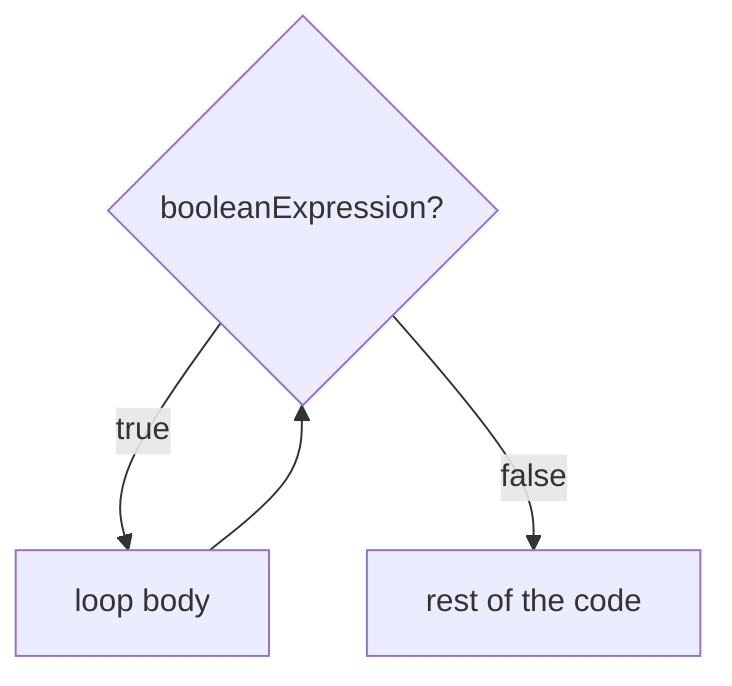

- TOC
{:toc}

## Repeating work

A **loop** runs a block of code repeatedly, as long as a boolean expression stays `true`. Loops let a short program do a large amount of work, such as adding up a million numbers or checking every item in an [array]({{ site.baseurl }}/comp1010/comp1000-revision/arrays).

## `while` loops

```java
while (booleanExpression) {
    // loop body
}
// rest of the code
```



The expression is checked **before each repetition** (each *iteration*). If it is `true`, the body runs and Java goes back to check again. As soon as it is `false`, the loop ends. If it is `false` the very first time, the body never runs at all.

Example: add up the integers from 1 to 5.

```java
int total = 0;
int i = 1;
while (i <= 5) {
    total = total + i;
    i++;
}
System.out.println(total);   // 15
```

## Tracing a loop

The most reliable way to understand a loop, or to find a bug in one, is to **trace** it: write down the values of the variables each time the condition is checked.

| Check # | `i` | `total` | `i <= 5`? | Action                        |
|---------|-----|---------|-----------|-------------------------------|
| 1       | 1   | 0       | `true`    | `total = 0 + 1`, `i` becomes 2  |
| 2       | 2   | 1       | `true`    | `total = 1 + 2`, `i` becomes 3  |
| 3       | 3   | 3       | `true`    | `total = 3 + 3`, `i` becomes 4  |
| 4       | 4   | 6       | `true`    | `total = 6 + 4`, `i` becomes 5  |
| 5       | 5   | 10      | `true`    | `total = 10 + 5`, `i` becomes 6 |
| 6       | 6   | 15      | `false`   | loop ends                     |

Notice that:

- the condition is checked **6** times, but the body runs only **5** times,
- after the loop, `i` is `6`, the first value that made the condition `false`.

Each line of the body is an ordinary [two-step assignment]({{ site.baseurl }}/comp1010/comp1000-revision/variables-and-operators#assignment-is-a-two-step-operation). In `total = total + i`, the RHS uses the values of `total` and `i` from *before* the statement runs.

## The three parts of a counting loop

Almost every counting loop has three parts:

1. **Initialisation**: set up the loop variable (`int i = 1;`)
2. **Condition**: decide whether to keep going (`i <= 5`)
3. **Update**: move towards the end (`i++`)

If you forget the update, the condition never changes and the loop runs forever (an **infinite loop**):

```java
int i = 1;
while (i <= 5) {
    total = total + i;
    // forgot i++ - i stays 1 forever
}
```

## `for` loops

A `for` loop puts all three parts on one line, so it is harder to forget any of them:

```java
for (initialisation; condition; update) {
    // loop body
}
```

The order of execution is:

1. initialisation (once only)
2. check the condition. If `false`, the loop ends.
3. run the body
4. run the update, then go back to step 2

The sum from 1 to 5 as a `for` loop:

```java
int total = 0;
for (int i = 1; i <= 5; i++) {
    total = total + i;
}
```

This does exactly the same as the `while` version. One difference: a variable declared in the initialisation (`int i`) only exists inside the loop. Using `i` after the loop is a compilation error.

{: .note}
> **`for` or `while`?** Use a `for` loop when you know how many times to repeat (or can work it out), for example "for each index of an array". Use a `while` loop when you repeat *until something happens*, for example "until the number reaches 1".

### Common loop headers

```java
for (int i = 0; i < n; i++)      // 0, 1, 2, ..., n-1      (n iterations)
for (int i = 1; i <= n; i++)     // 1, 2, 3, ..., n        (n iterations)
for (int i = n; i >= 1; i--)     // n, n-1, ..., 1         (n iterations)
for (int i = 0; i < n; i += 2)   // 0, 2, 4, ...           (every second value)
```

## Loop patterns

Most loops you will write are one of a handful of patterns.

### Accumulate (sum, product, count)

Start a variable at a neutral value, then update it on each iteration.

```java
// sum of the squares of 1..n
int sumSq = 0;
for (int i = 1; i <= n; i++) {
    sumSq = sumSq + i * i;
}

// count how many numbers in 1..n are divisible by 3 or 5
int count = 0;
for (int i = 1; i <= n; i++) {
    if (i % 3 == 0 || i % 5 == 0) {
        count++;
    }
}
```

### Repeat until a condition holds

```java
// number of digits in a positive integer n
int digits = 0;
while (n > 0) {
    n = n / 10;     // integer division removes the last digit
    digits++;
}
```

### Search, and stop early

```java
// is n a prime number? (assuming n >= 2)
boolean isPrime = true;
int d = 2;
while (d < n && isPrime) {
    if (n % d == 0) {
        isPrime = false;
    }
    d++;
}
```

The condition `d < n && isPrime` makes the loop stop as soon as a divisor is found.

## Nested loops

The body of a loop can contain another loop. For each single iteration of the outer loop, the inner loop runs through **all** of its iterations.

```java
for (int row = 1; row <= 3; row++) {
    for (int col = 1; col <= 4; col++) {
        System.out.print(row * col + "\t");
    }
    System.out.println();
}
```

Output:

```
1	2	3	4
2	4	6	8
3	6	9	12
```

The inner body runs 3 × 4 = 12 times in total.

The inner loop can depend on the outer loop variable:

```java
for (int row = 1; row <= 4; row++) {
    for (int col = 1; col <= row; col++) {
        System.out.print("*");
    }
    System.out.println();
}
```

```
*
**
***
****
```

## Common mistakes

### Off-by-one errors

The loop runs one time too many or one time too few. Check the first and last values of the loop variable carefully. Does `<` or `<=` give you what you want?

```java
for (int i = 1; i < 10; i++)    // 1 to 9 - nine iterations
for (int i = 1; i <= 10; i++)   // 1 to 10 - ten iterations
```

### A semicolon after the header

```java
for (int i = 0; i < 5; i++); {
    System.out.println("hello");   // prints only once!
}
```

As with `if`, the `;` gives the loop an empty body. The block afterwards runs once, after the loop finishes.

### Resetting a variable inside the loop

```java
for (int i = 1; i <= 5; i++) {
    int total = 0;          // reset on EVERY iteration
    total = total + i;
}
```

Variables that should keep their values across iterations, such as an accumulator, must be declared **before** the loop.

## Exercises


Trace the following code. What is the output?

```java
int a = 1;
int b = 1;
while (b < 20) {
    int temp = a + b;
    a = b;
    b = temp;
}
System.out.println(a + " " + b);
```


| check | `a` | `b` | `b < 20`? |
|-------|-----|-----|-----------|
| 1     | 1   | 1   | true      |
| 2     | 1   | 2   | true      |
| 3     | 2   | 3   | true      |
| 4     | 3   | 5   | true      |
| 5     | 5   | 8   | true      |
| 6     | 8   | 13  | true      |
| 7     | 13  | 21  | false     |

Output: `13 21`. These are consecutive Fibonacci numbers.




How many times does each loop body run?

```java
for (int i = 0; i < 10; i++) { ... }        // (a)
for (int i = 10; i > 0; i -= 3) { ... }     // (b)
for (int i = 1; i <= 100; i *= 2) { ... }   // (c)
for (int i = 5; i < 5; i++) { ... }         // (d)
```


- (a) 10 times (`i` = 0 to 9)
- (b) 4 times (`i` = 10, 7, 4, 1)
- (c) 7 times (`i` = 1, 2, 4, 8, 16, 32, 64)
- (d) 0 times. The condition is `false` the very first time it is checked.




Write a loop that computes the sum of the digits of a positive `int n`. For example, for `n = 4096` the sum is 4 + 0 + 9 + 6 = 19.


```java
int sum = 0;
while (n > 0) {
    sum = sum + n % 10;   // last digit
    n = n / 10;           // remove last digit
}
```




The following code is meant to compute 1 × 2 × ... × `n` (n factorial). Find the bugs.

```java
int product = 0;
for (int i = 1; i < n; i++) {
    product = product * i;
}
```


1. `product` starts at `0`, so it stays `0` forever. The neutral value for multiplication is `1`.
2. `i < n` stops before multiplying by `n`. It should be `i <= n`.

```java
int product = 1;
for (int i = 1; i <= n; i++) {
    product = product * i;
}
```




Using nested loops, print the following pattern for a given `n` (shown here for `n = 4`):

```
1
12
123
1234
```


```java
for (int row = 1; row <= n; row++) {
    for (int col = 1; col <= row; col++) {
        System.out.print(col);
    }
    System.out.println();
}
```


