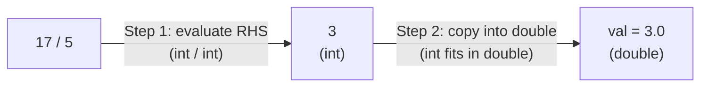
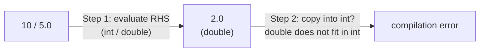

- TOC
{:toc}

## A one-line puzzle

What value does `val` hold after this statement executes?

```java
double val = 17 / 5;
```

Most people say `3.4`. After all, 17 divided by 5 *is* 3.4, and `val` is a `double`, which can certainly hold 3.4.

The answer is **`3.0`**.

To see why, we work backwards from this one statement. Along the way we pick up almost everything you need to know about variables, values, types and operators.

## Assignment is a two-step operation

The single most important idea on this page:

{: .keynote}
> An assignment `variable = expression;` happens in **two separate steps**:
>
> 1. **Evaluate the right-hand side (RHS).** The expression is computed on its own, producing a single value *of a particular type*. The RHS has no idea what variable the result is going to.
> 2. **Copy the value into the left-hand side (LHS).** Java then *attempts* to copy that value into the variable. The copy only happens if the value's type is compatible with the variable's type. Otherwise the program does not compile.

Applied to our puzzle:



The `double` on the left plays **no part** in step 1. By the time Java looks at `val`, the RHS has already been reduced to the integer `3`. The `.4` was gone before `val` was involved.

Let's look at each step in detail.

## Step 1: Evaluating the RHS

### Every value has a type

A *literal* is a value written directly in the code. Java decides the type of a literal from the way it is written:

| Literal      | Type      | Why                                    |
|--------------|-----------|----------------------------------------|
| `17`         | `int`     | whole number, no decimal point         |
| `5`          | `int`     | whole number, no decimal point         |
| `5.0`        | `double`  | has a decimal point                    |
| `17.`        | `double`  | has a decimal point (even with no digits after it) |
| `true`       | `boolean` | one of the two boolean literals        |
| `'A'`        | `char`    | single character in single quotes      |
| `"17"`       | `String`  | text in double quotes (not a number!)  |

So in `17 / 5`, both operands are of type `int`.

### The type of an operation depends only on its operands

An arithmetic operator looks at the types of its two operands to decide what kind of operation to perform and what type of result to produce:

| Left operand | Right operand | Operation performed      | Result type |
|--------------|---------------|--------------------------|-------------|
| `int`        | `int`         | integer arithmetic       | `int`       |
| `int`        | `double`      | `int` is converted to `double`, then floating-point arithmetic | `double` |
| `double`     | `int`         | `int` is converted to `double`, then floating-point arithmetic | `double` |
| `double`     | `double`      | floating-point arithmetic | `double`   |

For `/`, *integer arithmetic* means **integer division**: the result is the whole number of times the right operand fits into the left operand. Any fractional part is thrown away (not rounded).

```java
17 / 5      // 3     (int / int: 5 fits into 17 three times)
19 / 5      // 3     (not 4! the .8 is discarded, not rounded)
4 / 5       // 0
-17 / 5     // -3    (the fractional part is discarded, so the result moves towards zero)
17 / 5.0    // 3.4   (int / double: floating-point division)
17.0 / 5    // 3.4   (double / int: floating-point division)
```

So step 1 of `double val = 17 / 5;` produces the `int` value `3`.

### The remainder operator `%`

Integer division has a partner: `%` gives the **remainder** left over after integer division.

```java
17 % 5      // 2   (17 = 5 * 3 + 2)
20 % 5      // 0   (divides exactly)
4 % 5       // 4   (5 fits zero times, 4 left over)
```

`%` is very handy for questions such as "is `n` even?" (`n % 2 == 0`) or "what is the last digit of `n`?" (`n % 10`).

## Step 2: Copying the value into the LHS

After step 1, Java holds the value `3` of type `int`, and the variable `val` is of type `double`. Can the copy go ahead?

Yes. Every `int` value can be represented **exactly** as a `double`, so no information can be lost. Java converts `3` to `3.0` automatically and stores it in `val`.

```java
double val = 17 / 5;      // step 1: 3 (int)     step 2: val = 3.0
```

This automatic conversion is called a **widening conversion**. The value moves from a "narrower" type to a "wider" type that can hold every value the narrower type can.

## A second example: `int f = 10 / 5.0;`

```java
int f = 10 / 5.0;
```

Mathematically, 10 divided by 5 is exactly 2, so you might expect `f` to become `2`. In fact, **this statement does not compile**:

```
error: incompatible types: possible lossy conversion from double to int
```

Apply the two steps again:



1. **Evaluate the RHS.** `10` is an `int` and `5.0` is a `double`. One operand is a `double`, so `10` is converted to `10.0` and floating-point division gives `2.0`, of type **`double`**.
2. **Copy into the LHS.** Java now has to copy a `double` into an `int` variable, and it refuses.

### Why `int` → `double` is allowed but `double` → `int` is not

The rule is about **types, not values**. When Java checks step 2, it asks:

> *Could **any** value of the RHS type fail to fit in the LHS type?*

- **`int` → `double`: allowed.** Every possible `int` (any whole number from about -2.1 billion to +2.1 billion) can be stored exactly in a `double`. Nothing can be lost.
- **`double` → `int`: not allowed.** A `double` can hold values that an `int` cannot:
    - values with a fractional part, such as `2.5` or `-0.001`
    - values far outside the `int` range, such as `1e100`

  Copying such a value into an `int` would silently lose information, so Java rejects the statement at compile time.

It does not matter that the value in this particular case is `2.0`, which happens to be a whole number. The compiler checks the **type** of the RHS (`double`), not the specific value it will turn out to be when the program runs.

{: .note}
> Think of types as containers. A `double` container is big enough to hold anything an `int` container holds, so pouring an `int` into a `double` is always safe. Pouring a `double` into an `int` might overflow or spill the fractional part, so Java won't let you do it without explicitly saying so.

### Fixing the two examples

If you *wanted* `val` to be `3.4`, make at least one operand a `double` **before** the division happens:

```java
double val = 17 / 5.0;          // 3.4
double val = 17.0 / 5;          // 3.4
double val = (double) 17 / 5;   // 3.4  - the cast applies to 17, then 17.0 / 5
double val = (double) (17 / 5); // 3.0  - the cast happens AFTER integer division. Too late!
```

If you really do want to put a `double` into an `int`, you must say so explicitly with a **cast**. That tells Java you accept losing the fractional part:

```java
int f = (int) (10 / 5.0);   // 2
int g = (int) 3.99;         // 3   - a cast truncates, it does not round
```

Or avoid the `double` altogether:

```java
int f = 10 / 5;             // 2
```

## Variables

Now that we understand assignment, the rest falls into place.

A **variable** is a named location in memory that holds a value of one fixed type. The type is chosen when the variable is **declared** and can never change.

```java
int count;            // declaration: a variable named count that can hold int values
count = 5;            // assignment
int total = 0;        // declaration and initialisation in one statement
double price = 4.95;
boolean done = false;
```

A variable's name:

- can contain letters, digits, `_` and `$`,
- cannot start with a digit,
- cannot be a Java reserved word (`int`, `if`, `class`, ...),
- is case-sensitive (`total` and `Total` are different variables).

By convention, Java variable names use *camelCase*: `numberOfStudents`, `maxValue`.

### Variables on both sides

Because the RHS is evaluated *before* the copy happens, a variable can appear on both sides of an assignment:

```java
int x = 5;
x = x + 1;     // step 1: x + 1 → 5 + 1 → 6     step 2: x = 6
```

The `x` on the right means "the current value of `x`". The `x` on the left means "the variable `x`, where the result will be stored". This is why `=` is pronounced "becomes" or "gets", not "equals".

Java provides shorthand for these common updates:

```java
x += 3;    // x = x + 3;
x -= 3;    // x = x - 3;
x *= 3;    // x = x * 3;
x /= 3;    // x = x / 3;
x %= 3;    // x = x % 3;
x++;       // x = x + 1;
x--;       // x = x - 1;
```

{: .warning}
> The shorthand operators hide a cast. `int x = 5; x += 2.5;` compiles and makes `x` equal to `7`, while `x = x + 2.5;` does not compile. This is a rare exception to the two-step rule, so watch out for it.

## Other operators

The two-step rule applies whatever operator appears on the RHS. Each operator takes operands of certain types and produces a result of a certain type.

### Relational operators

These compare two numbers and produce a `boolean`:

| Operator | Meaning                  | Example   | Result  |
|----------|--------------------------|-----------|---------|
| `==`     | equal to                 | `7 == 7`  | `true`  |
| `!=`     | not equal to             | `7 != 7`  | `false` |
| `<`      | less than                | `3 < 7`   | `true`  |
| `<=`     | less than or equal to    | `7 <= 7`  | `true`  |
| `>`      | greater than             | `3 > 7`   | `false` |
| `>=`     | greater than or equal to | `3 >= 7`  | `false` |

```java
boolean passed = mark >= 50;   // step 1: evaluate mark >= 50 → true or false
                               // step 2: copy the boolean into passed
```

Do not confuse `=` (assignment) with `==` (comparison).

### Logical operators

These combine `boolean` values and produce a `boolean`:

| Operator | Meaning | Result is `true` when           |
|----------|---------|---------------------------------|
| `&&`     | AND     | both operands are `true`        |
| <code>&#124;&#124;</code> | OR | at least one operand is `true` |
| `!`      | NOT     | the operand is `false`          |

```java
boolean inRange = x >= 10 && x <= 20;
boolean isWeekend = day == 6 || day == 7;
boolean isWeekday = !isWeekend;
```

### Precedence

When an expression contains several operators, Java evaluates them in this order (highest first). Operators on the same level are evaluated left to right.

| Level | Operators                          |
|-------|------------------------------------|
| 1     | `( )`                              |
| 2     | `!`, unary `-`, casts such as `(int)` |
| 3     | `*`, `/`, `%`                      |
| 4     | `+`, `-`                           |
| 5     | `<`, `<=`, `>`, `>=`               |
| 6     | `==`, `!=`                         |
| 7     | `&&`                               |
| 8     | <code>&#124;&#124;</code>          |
| 9     | `=`, `+=`, `-=`, ...               |

Assignment has the **lowest** precedence. This is just the two-step rule again: the entire RHS is evaluated before the assignment happens.

Each operation happens one at a time, and each produces a value with its own type:

```java
double d = 7 / 2 + 1.5;
// 7 / 2       → 3     (int / int)
// 3 + 1.5     → 4.5   (int + double)
// d = 4.5
```

## Exercises


What is the value of each variable after the statement executes?

```java
int a = 23 / 4;
double b = 23 / 4;
double c = 23 / 4.0;
int d = 23 % 4;
```


- `a` is `5`. `23 / 4` is integer division.
- `b` is `5.0`. Step 1 gives `5` (int), and step 2 widens it to `5.0`.
- `c` is `5.75`. `23 / 4.0` is floating-point division.
- `d` is `3`, because 23 = 4 × 5 + 3.




Which of the following statements compile? For those that don't, explain using the two-step view of assignment.

```java
double p = 8;
int q = 8.0;
int r = 9 / 3;
int s = 9 / 3.0;
double t = 9 / 3.0;
int u = (int) 9.99;
```


- `double p = 8;` compiles. The RHS is `8` (int), and an `int` can be copied into a `double`, so `p` is `8.0`.
- `int q = 8.0;` does **not** compile. The RHS is a `double` and could hold a fraction, so it can't be copied into an `int`.
- `int r = 9 / 3;` compiles, and `r` is `3`.
- `int s = 9 / 3.0;` does **not** compile. The RHS evaluates to `3.0`, which is a `double`. The value happens to be whole, but its *type* is `double`.
- `double t = 9 / 3.0;` compiles, and `t` is `3.0`.
- `int u = (int) 9.99;` compiles, and `u` is `9`. The explicit cast truncates.




What is the value of `avg` after the following code executes? Fix the code so that `avg` holds the correct average.

```java
int total = 250;
int count = 4;
double avg = total / count;
```


`avg` is `62.0`, not `62.5`. Step 1 evaluates `total / count` as `int / int`, which gives `62`. Step 2 widens it to `62.0`.

Fix: make one operand a `double` before the division happens.

```java
double avg = (double) total / count;   // 62.5
```

Note that `(double) (total / count)` would still give `62.0`, because the cast comes too late.




What are the values of `x`, `y` and `z` after this code executes?

```java
int x = 7;
int y = x / 2 * 2;
double z = x / 2 * 2.0;
x = x % 2 + y;
```


- `y`: `7 / 2` → `3`, then `3 * 2` → `6`.
- `z`: `7 / 2` → `3`, then `3 * 2.0` → `6.0`.
- `x`: the RHS uses the *current* value of `x`, which is 7. `7 % 2` → `1`, then `1 + 6` → `7`. So `x` becomes `7`.




What is the value of `flag`?

```java
boolean flag = true || true && false;
```


`true`. `&&` has higher precedence than `||`, so the expression is `true || (true && false)` → `true || false` → `true`.




Write a single statement that declares a `boolean` variable `isLeap` and assigns it `true` if and only if the `int` variable `year` holds a leap year.

A year is a leap year if it is divisible by 4, except for years divisible by 100, which are leap years only if they are also divisible by 400.


```java
boolean isLeap = (year % 4 == 0 && year % 100 != 0) || year % 400 == 0;
```


